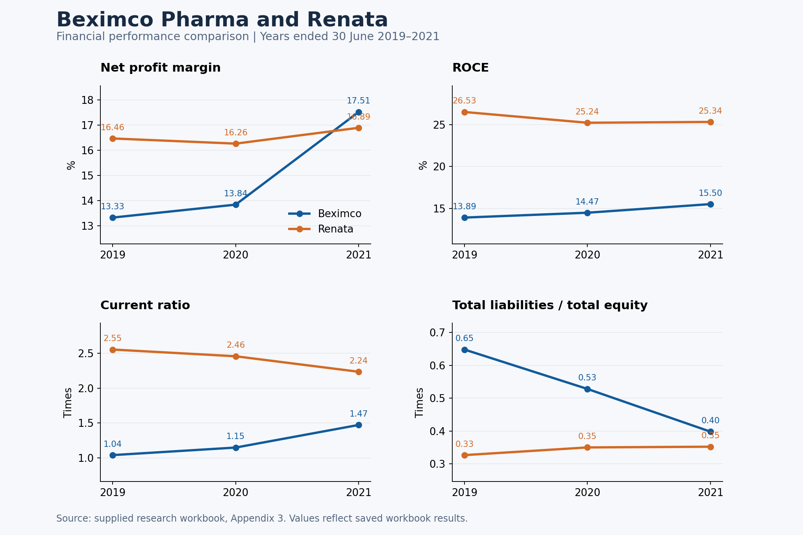

# Beximco Pharma: Business and Financial Performance Analysis

A research portfolio evaluating Beximco Pharmaceuticals Limited against Renata Limited for the financial years ended 30 June 2019, 2020 and 2021.

The project combines Excel financial ratio analysis with PESTLE and SWOT frameworks to examine how company strategy and the business environment relate to performance.

## Explore the project

- [Excel financial analysis](analysis/financial-analysis.xlsx): company financial statements, linked ratio calculations and charts.
- [Research presentation](presentation/research-presentation.pptx): objectives, research approach, business analysis, financial discussion and recommendations.
- [Key ratios in CSV format](data/key-ratios.csv): selected saved workbook results, including source cells.
- [Methodology and definitions](docs/methodology.md): ratio formulas and interpretation.
- [Source and data notes](docs/source-notes.md): provenance and issues to consider when using the figures.

Download the Excel workbook to inspect the calculations. Download the PowerPoint file to view the complete presentation. The CSV and this README can be read directly on GitHub.

## Research question

How did Beximco's business and financial performance change during 2019–2021, and how did its profitability, efficiency, liquidity and financial position compare with Renata?

## Selected results

| Metric | Beximco 2019 | Beximco 2021 | Renata 2019 | Renata 2021 |
|---|---:|---:|---:|---:|
| Net profit margin | 13.33% | 17.51% | 16.46% | 16.89% |
| ROCE | 13.89% | 15.50% | 26.53% | 25.34% |
| Asset turnover | 0.46× | 0.56× | 0.92× | 0.86× |
| Current ratio | 1.04× | 1.47× | 2.55× | 2.24× |
| Operating cash flow ratio | 0.23× | 0.64× | 0.89× | 0.56× |
| Total liabilities / total equity | 0.65× | 0.40× | 0.33× | 0.35× |
| Total liabilities / total assets | 39.32% | 28.48% | 24.64% | 26.06% |

Beximco's net profit margin rose from 13.33% to 17.51%, exceeding Renata's 16.89% in 2021. Its current ratio improved from 1.04 to 1.47, while total liabilities relative to equity fell from 0.65 to 0.40.

Renata retained higher ROCE and asset turnover throughout the period. Beximco's improving results therefore do not establish that it outperformed its comparator on every measure.

These results reproduce the saved workbook values. “Debt” ratios in the original workbook use total liabilities, including non-borrowing liabilities. The table uses labels that reflect that calculation.

## Research approach

The supplied presentation describes secondary research using company annual reports, published media, journals and academic textbooks. Financial statement inputs are organized separately for each company, with Excel formulas linking those inputs to ratios and chart data. PESTLE and SWOT analysis provide context for the financial trends.

The presentation discusses product development, export activity, manufacturing expansion and pandemic-related opportunities as potential explanations for Beximco's performance. Those explanations are the original project's interpretation and are not causal estimates.

## Recommendations from the research

The presentation recommends increasing research and development investment and expanding active pharmaceutical ingredient (API) production to reduce dependence on imported inputs. These recommendations belong to the historical 2019–2021 study.

## Skills demonstrated

- Excel financial modeling with formulas linked across worksheets.
- Financial statement interpretation and competitor benchmarking.
- Profitability, liquidity, efficiency and leverage ratio analysis.
- Application of PESTLE and SWOT to business performance.
- Research communication through charts and a structured presentation.

## Scope and sources

This repository contains the supplied research workbook and presentation, plus documentation and a chart prepared from their contents. It does not include the complete written research report or copies of the underlying annual reports. See [source notes](docs/source-notes.md) for data definitions and limitations.

The analysis covers 2019–2021. It should be interpreted as historical research.
